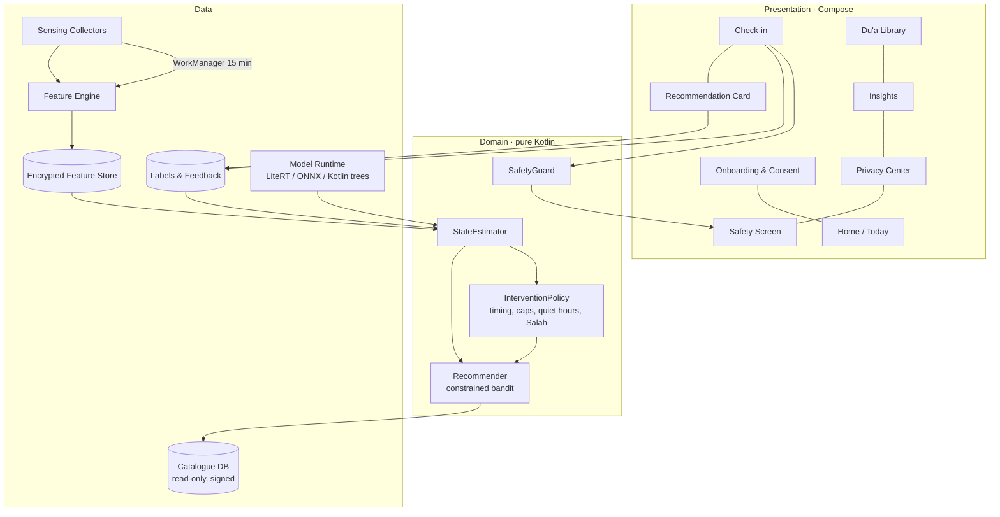

# Component Architecture — ARC-02 v1.0-rc (C4 level 2–3)

## 1. Layered, modular Android app (Kotlin, Jetpack Compose, Hilt, Room+SQLCipher, WorkManager)

## 2. Gradle modules
| Module | Responsibility | Depends on |
|---|---|---|
| `:app` | DI wiring, navigation | all |
| `:feature:onboarding`, `:feature:checkin`, `:feature:library`, `:feature:insights`, `:feature:privacy`, `:feature:safety` | UI features | `:core:*` |
| `:core:sensing` | Usage/screen/activity collectors | `:core:data` |
| `:core:features` | Windowing, baselines (spec: 04-ai-ml/feature-specifications) | — |
| `:core:inference` | Model runtime, cold-start rules, personalisation | `:core:features` |
| `:core:recommender` | Bandit, constraints, explanation strings | `:core:content` |
| `:core:content` | Catalogue loader, signature verification | — |
| `:core:policy` | Notification timing, Salah times, quiet hours | prayer-time lib |
| `:core:data` | Room + SQLCipher, retention jobs | — |
| `:core:safety` | Crisis rules, helpline directory | — |

## 3. Operating modes
- **Full mode:** passive sensing + check-ins.
- **Check-in-only mode** (FR-02): no collectors scheduled; the recommender uses the check-in state and time of day.
- **Paused:** collectors stopped; the library is still usable.

## 4. Optional backend (M5+, research only)
A minimal FastAPI (or equivalent) ingestion endpoint, a pseudonymous participant ID, a TLS-only encrypted store, and no user accounts in the MVP.

## 5. Module → requirement map (T-M2-009)
| Gradle module | SRS module | Requirements | Interface (ARC-06) |
|---|---|---|---|
| `:feature:onboarding` | MOD-ON | FR-01, FR-02, PR-03, PR-05, SR-02 | — |
| `:core:sensing` | MOD-SN | FR-03..FR-07, PR-01, PR-04 | Collectors (WorkManager) |
| `:core:features` | MOD-FE | FR-08, FR-09 | FeatureWindow |
| `:core:inference` | MOD-SI | FR-10..FR-12, NFR-02, PR-07 | StateEstimator |
| `:feature:checkin` | MOD-EM | FR-13, FR-14, SR-03 | InterventionPolicy |
| `:core:recommender` | MOD-RE | FR-15..FR-17, FR-29, NFR-08, CR-05 | Recommender |
| `:core:content`, `:feature:library` | MOD-CC | FR-18..FR-20, CR-01..CR-07 | CatalogueRepository (ADR-0005) |
| `:core:policy` | MOD-NT | FR-21, FR-22 | InterventionPolicy |
| `:feature:insights` | MOD-IN | FR-23 | — |
| `:core:safety`, `:feature:safety` | MOD-SF | FR-24, SR-01..SR-05 | SafetyGuard (SAF-01) |
| `:feature:privacy`, `:core:data` | MOD-PC | FR-25, FR-26, PR-02, PR-06 | Retention and delete-all (ARC-04 §2–§3) |
| backend (M5+) | MOD-RS | FR-27, PR-03 | Research ingestion (ARC-06 §3) |
| `:app` | MOD-ST | FR-28, NFR-05 | — |

Every SRS module has an owning Gradle module; one owner per path (AGS-04).

## 6. ADR status for G2
| ADR | Status now | Accept at G2 if |
|---|---|---|
| ADR-0001 Android-first, min SDK 28 | Proposed | SPK-01 confirms screen/keyguard events on API 28+ devices |
| ADR-0002 No AccessibilityService / IME | Proposed | Already confirmed by Play policy (SPK-02) and the threat model; recommend accept |
| ADR-0003 On-device open-source ML | Accepted | — (runtime choice LiteRT vs ONNX after SPK-05) |
| ADR-0004 Curated verified content | Accepted | — |
| ADR-0005 Signed approved-only catalogue | Proposed | AG-09 review of key handling |

## 7. As built in M5 (T-M5-001, 2026-10-21) — deviations from §1–§2
| Planned | Built | Why |
|---|---|---|
| Hilt for DI | Manual wiring (`AppContainer`) | Seven modules; a DI framework adds an annotation processor for no current benefit. Revisit when screens get ViewModels with scoped dependencies |
| Room + SQLCipher | SQLCipher directly (`:core:data`, `BcsrStore`) | Ten simple tables; avoids a KSP/Room toolchain tied to the Kotlin version |
| `:feature:*` modules | Feature packages inside `:app` (`MainActivity.kt` screens) | Six screens share little; split when a feature grows or gets its own owner |
| `:core:policy` with a prayer-time library | `:core:policy` uses the Java edition of Adhan (`com.batoulapps.adhan:adhan:1.2.1`) | `adhan2` 0.0.7 needs Kotlin 2.4 and 0.0.6 needs Java 21 bytecode; the build is Kotlin 2.2 / JDK 17 |
| Ed25519 via the platform | BouncyCastle `bcprov-jdk18on` | Android's Ed25519 needs API 33; min SDK is 28 |

Modules: `:app`, `:core:data` (Android), and pure-Kotlin `:core:policy`, `:core:features`, `:core:inference`, `:core:recommender`, `:core:content`, `:core:safety` (JVM unit tests run in CI). `:core:sensing` follows G2 (T-M5-003).
