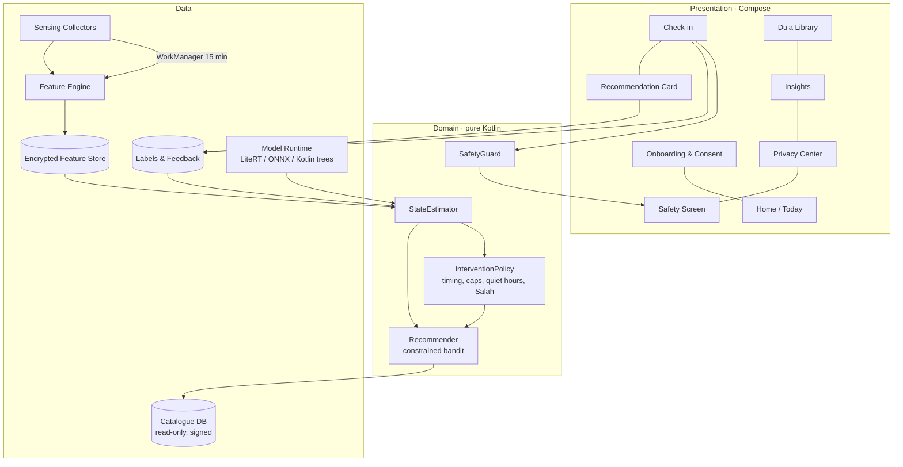

# Component Architecture — ARC-02 v0.1 (C4 level 2–3)

## 1. Layered, modular Android app (Kotlin, Jetpack Compose, Hilt, Room+SQLCipher, WorkManager)

## 2. Gradle modules
| Module | Responsibility | Depends on |
|---|---|---|
| `:app` | DI wiring, navigation | all |
| `:feature:onboarding`, `:feature:checkin`, `:feature:library`, `:feature:insights`, `:feature:privacy`, `:feature:safety` | UI features | `:core:*` |
| `:core:sensing` | Usage/screen/activity collectors | `:core:data` |
| `:core:features` | Windowing, baselines (spec: 04-ai-ml/feature-specifications) | — |
| `:core:inference` | Model runtime, cold-start rules, personalisation | `:core:features` |
| `:core:recommender` | Bandit, constraints, explanation strings | `:core:content` |
| `:core:content` | Catalogue loader, signature verification | — |
| `:core:policy` | Notification timing, Salah times, quiet hours | prayer-time lib |
| `:core:data` | Room + SQLCipher, retention jobs | — |
| `:core:safety` | Crisis rules, helpline directory | — |

## 3. Operating modes
- **Full mode:** passive sensing + check-ins.
- **Check-in-only mode** (FR-02): no collectors scheduled; the recommender uses the check-in state and time of day.
- **Paused:** collectors stopped; the library is still usable.

## 4. Optional backend (M5+, research only)
A minimal FastAPI (or equivalent) ingestion endpoint, a pseudonymous participant ID, a TLS-only encrypted store, and no user accounts in the MVP.
