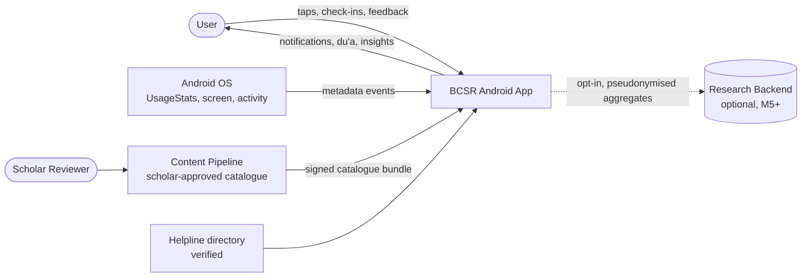

# System Context — ARC-01 v0.1 (C4 level 1)

## Boundaries
- **Trust boundary 1:** device ↔ network. Only the signed catalogue (inbound) and consented aggregates (outbound) cross it.
- **Trust boundary 2:** content pipeline. Only items approved by a scholar are packaged into the signed bundle.
- The app is fully functional offline. The research backend is optional and does not exist in the MVP critical path.
