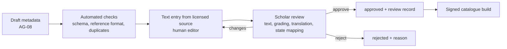

# Verification Workflow — CON-03 v0.1

## Review record (`review-records/RR-NNNN.md`)
Item ID · reviewer name & qualification · date · checks (Arabic exact ✔, reference ✔, grading ✔ with source, translation ✔, mapping ✔) · decision · notes.

## Rules
- Two-person rule for Arabic text: the editor enters it and the scholar verifies it.
- Any edit to an approved item resets its status to `in_review`.
- Quarterly re-audit of 10% of items.
