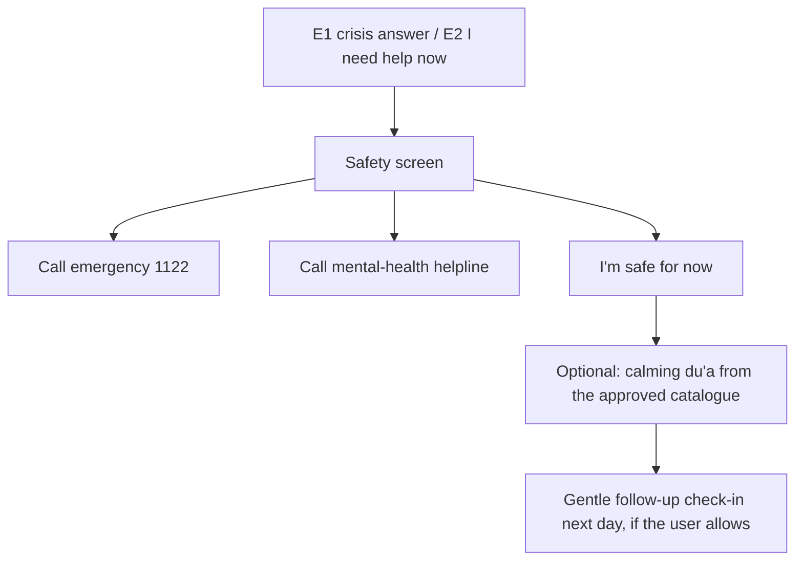

# Safety Pathway — SAF-01 v1.0-rc

Task: T-M1-011 · Owner: AG-10 (SK-10) · Approver: Project Lead (D-011, in place of a mental-health advisor) · Requirements: FR-24, SR-01..SR-05, AGENTS.md §4.

**Status: signed by the Project Lead 2026-10-21 (PR #18).** No mental-health professional has reviewed this pathway (D-011, risk R-05 accepted at 15).

## 1. Principles
1. **Human help first.** In a crisis the app shows helplines and an emergency action before anything else. A du'a is offered only after, and never instead (AGENTS.md §4).
2. **Explicit input only.** The pathway opens only when the user says so: a crisis answer in a check-in, or the "I need help now" control. Phone signals never open it (SR-03).
3. **Not a medical service.** The app says so in onboarding, on the safety screen and on the about screen (SR-02).
4. **No judgement, no guilt.** Copy never suggests weak faith, punishment or blame; negative religious framing is linked to worse outcomes (RES-02 S21, S22).
5. **Minimal logging.** Only a local counter of how often the screen was opened. Nothing is uploaded, even with research consent (AC-FR-24).

## 2. Entry points
| Entry | Where | Trigger |
|---|---|---|
| E1 | Check-in | The user picks the crisis option, worded as "I'm not safe / I might hurt myself" |
| E2 | Persistent control | "I need help now" on the home screen and in the menu, one tap |
| E3 | (Not in MVP) | Free-text detection: excluded, because the MVP has no free-text check-in (RES-03 §1) |

## 3. Flow

- **Safety screen (one screen, no scrolling needed):** a short heading, the emergency action, the helplines for the user's region from the directory (SAF-02), and "I'm safe for now".
- **Region:** Pakistan only in the MVP. If the user's region has no verified helpline, the safety screen still shows the emergency action, and that locale is blocked from release (SK-10 step 4).
- **After "I'm safe for now":** offer one approved du'a for distress (content from T-M1-010, scholar-approved). Never auto-play, never show before the helplines.
- **No recommendation or notification** is sent for 24 h after the pathway opens, except the follow-up the user allowed.

## 4. Copy (draft; Urdu must be checked by a native speaker before release)
| Element | English | Urdu |
|---|---|---|
| Heading | You don't have to go through this alone. | آپ کو یہ اکیلے برداشت نہیں کرنا۔ |
| Body | If you might be in danger, please call for help now. | اگر آپ کو خطرہ ہو سکتا ہے تو ابھی مدد کے لیے کال کریں۔ |
| Emergency button | Call emergency (1122) | ایمرجنسی کال کریں (1122) |
| Helpline button | Talk to someone: [helpline name] | کسی سے بات کریں: [ہیلپ لائن کا نام] |
| Safe option | I'm safe for now | میں ابھی محفوظ ہوں |
| Disclaimer | BCSR is not a medical or counselling service. | BCSR کوئی طبی یا کاؤنسلنگ سروس نہیں ہے۔ |
| After safe | Would you like a du'a for distress? | کیا آپ پریشانی کے لیے ایک دعا دیکھنا چاہیں گے؟ |

Not allowed in any safety copy: diagnosis ("you are depressed"), religious blame ("pray more", "weak iman"), promises of cure, or a du'a in place of help.

## 5. Maintenance
- Helpline directory (SAF-02) reviewed at least every 3 months (SR-05); an entry older than 3 months blocks a release.
- Any change to this pathway's flow or copy needs the Project Lead's signature again (SR-04, AC-SR-04).

## 6. Sign-off
| Version | Date | Approver | Decision |
|---|---|---|---|
| 1.0 | 2026-10-21 | Muhammad Usman, Project Lead (D-011) | Approved via PR #18 |
