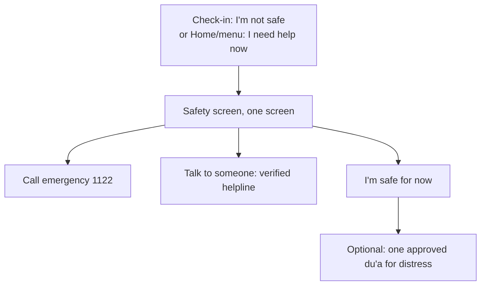

# UX-04 Safety (low-fi)

Task: T-M2-011 · Owner: AG-12 with AG-10 · Stories: US-09, US-22 · Requirements: FR-24, SR-01..SR-05 · Source of truth: SAF-01 (signed by the Project Lead, D-011)

This flow implements SAF-01 §3 unchanged; any difference is a bug in this file.

- Screen layout: heading and one line of body text, then the **emergency button first**, the helpline button(s), "I'm safe for now", and the disclaimer at the bottom (SAF-01 §4 copy).
- High contrast, large buttons (NFR-05); works offline (NFR-01) because calls use the phone dialer.
- No recommendation or other notification for 24 h afterwards, except a next-day check-in the user allows (SAF-01 §3).
- "I need help now" is reachable in **one tap** from Home and the menu.

**SK-10 checklist, self-check by the author.** The independent AG-10 review of this UX-04 flow is still pending; the Locked screen alone was reviewed by AG-10 and signed in SAF-01 v1.1 (HC-06-T-M5-025): crisis path present ✔ · help shown before any du'a ✔ · ask-not-assert tone ✔ · no guilt framing ✔ · Project Lead safety gate (D-011) ✔ · locale without a verified helpline blocks release ✔ (SAF-02). Checked against SAF-01 v1.0 on 2026-10-21.
