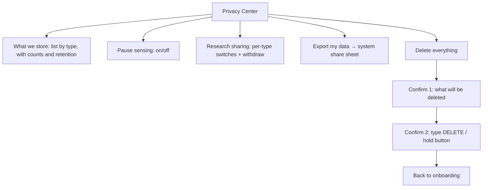

# UX-05 Privacy Center (low-fi)

Task: T-M2-011 · Owner: AG-12 · Stories: US-08, US-12, US-18, US-21 · Requirements: FR-25, FR-26, FR-27, PR-02, PR-03, PR-06 · Design: ARC-04 §2–§3

- "What we store" shows real counts per entity ("Usage events: 1,240, kept 30 days") so users see exactly what exists (TH-03).
- Pause takes effect at once and survives restarts (AC-FR-26).
- Export goes only through the share sheet; the temporary file is deleted after sharing (TH-10).
- Delete-all follows ARC-04 §3, including the research withdrawal message if research sharing was ever on.
