# Dependencies — PM-03 v0.1

## 1. Critical path (M0–M3)

```mermaid
flowchart LR
  A[T-M0-001 Repo] --> B[T-M0-002 AGENTS.md] --> C[T-M0-004 Charter] --> D[T-M0-009 G0]
  C --> S[T-M0-006 Scholar + MH advisor]
  S --> K[T-M1-010 Source policy] & L[T-M1-011 Safety pathway]
  D --> E[T-M1-001 M1 skills] --> F[T-M1-002 SRS] --> G[T-M1-004 Catalogue] --> H[T-M1-005 ACs] --> I[T-M1-007 Traceability]
  E --> R[T-M1-008 Evidence] --> DS[T-M1-013 Dataset strategy] --> IRB[T-M1-012 IRB]
  I & K & L & IRB --> J[T-M1-014 G1]
  J --> M[T-M2-000 M2 skills] --> N[T-M2-001 Usage spike] --> O[T-M2-004 OEM spike] --> P[T-M2-005 Budgets]
  N --> TM[T-M2-007 Threat model]
  O & TM --> Q[T-M2-009 Architecture]
  P & Q --> G2[T-M2-013 G2]
  G2 --> M31[T-M3-001 Gap analysis] --> M311[T-M3-011 Orchestration AGS-04] --> M312[T-M3-012 GitNexus tooling] --> M32[T-M3-002 Agents] --> M36[T-M3-006 Pilot dry-run] --> M38[T-M3-008 Skills v1.0] --> M39[T-M3-009 Backlog] --> G3[T-M3-010 G3]
```

## 2. External dependencies
| ID | Dependency | Needed by | Lead time | Risk |
|---|---|---|---|---|
| X-01 | Scholar reviewer availability | T-M1-010, all of M4 | 1–3 weeks to recruit | R-08 |
| X-02 | Mental-health advisor | T-M1-006, T-M1-011 | 1–3 weeks | R-05 |
| X-03 | Ethics/IRB approval | M5 pilot start | 4–8 weeks after submission | R-11 |
| X-04 | Test devices (≥ 5 OEMs, Android 9–15) | T-M2-001/004 | 1–2 weeks | R-06 |
| X-05 | Public dataset access approvals | T-M2-006 | 1–4 weeks | R-07 |
| X-06 | Licensed Qur'an text, translations, audio | M4 | Varies | R-10 |
| X-07 | Google Play developer account + policy declarations | M9 | 1 week + review time | R-02 |

## 3. Parallelism notes
- T-M0-006 (people) and T-M1-012 (IRB) have the longest external lead times. Start them as early as possible.
- M4 (content catalogue) can start right after T-M1-010 and runs in parallel with M2–M3, gated by scholar bandwidth.
- AG-12 interviews (T-M1-003) run in parallel with the evidence review.
