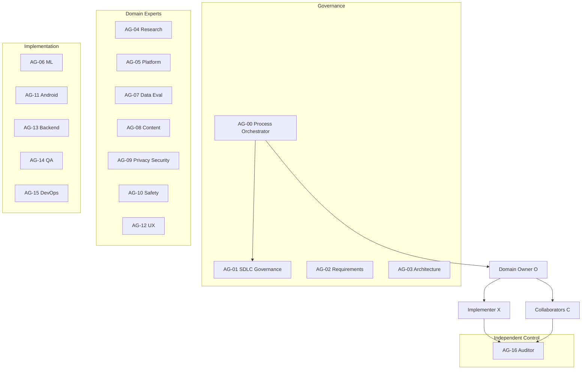
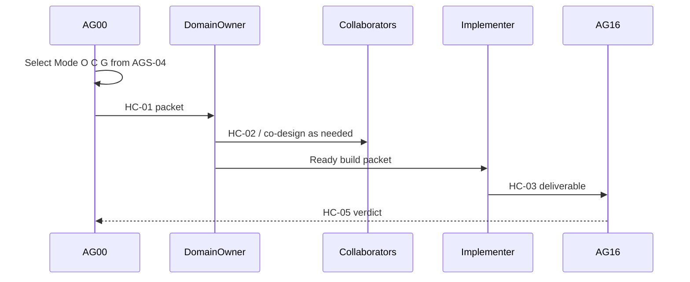

# Agent Collaboration Matrix — AGS-04 v0.1

> **Authority:** Agent-selection source for AG-00 (D-007). Extends AGS-01 registry and AGS-02 orchestration policy.  
> **Task:** T-M3-011  
> **Purpose:** For every change, answer who owns correctness, who must collaborate, who can block Done, and who implements.

## 1. Goal

| Question | Answered by |
|---|---|
| Who owns domain correctness? | **Owner (O)** |
| Who must co-design / review before build? | **Collaborators (C)** |
| Who can block Done / ship? | **Gates (G)** |
| Who writes artefacts / code? | **Implementer (X)** |
| Who is notified only? | **Informed (I)** |

**Selective invocation:** when Owner is unclear, load **AG-00 only**, output Mode / Owner / C / G / I / X from this matrix, then stop unless asked to continue as process orchestrator. Do not load every domain skill for one prompt.

## 2. Agent layers



**Layer rules:**

- Governance (AG-00) selects and sequences; it does not replace domain design.
- `docs/` + `AGENTS.md` + ADRs bind every Owner.
- Quality/control agents (especially AG-16) gate Done; human gates in `AGENTS.md` §7 are fail-closed.
- Implementation agents execute under Owner design (HC-02 when required).

## 3. RACI roles

| Role | Code | Meaning | Typical agents |
|---|---|---|---|
| Owner | **O** | Domain correctness; designs HC-02 when needed | Expert (or implementer for their write path) |
| Collaborator | **C** | Required review / co-design before Ready or build | Matrix row |
| Gate | **G** | May block Done / ship | AG-16 always; AG-09, AG-10, Scholar, MH advisor as listed |
| Informed | **I** | Notified; non-blocking | Adjacent Owners |
| Implementer | **X** | Writes under Owner design | AG-06, AG-11, AG-13, AG-14, AG-15 (and experts when they are the writer) |

**Authority hierarchy:**

```text
docs/ + AGENTS.md → ADR / Decision Log → AG-03 (architecture) / human gates
  → Domain Owner (O) → Implementer (X)
```

Conflict: **STOP → REPORT → ADR or HC-07 → AG-00 → Project Lead**. Security, safety, and content scholar gates are fail-closed.

## 4. Always-on checklist (minimum-sufficient)

For every feature or non-trivial change, AG-00 records which of these were **considered** and which were **not needed** (with reason):

| Concern | Agent | When needed |
|---|---|---|
| New capability / AC | AG-02 | New or changed Must/Should requirements |
| Module / API boundary | AG-03 | Cross-path or ADR-impacting change |
| Data / sensing / privacy | AG-09 | Signals, storage, consent, Play Data Safety |
| Emotional / crisis UX | AG-10 | Check-in copy, recommendations, crisis path |
| Religious catalogue | AG-08 + **Scholar** | Any Qur'an/Hadith/du'a catalogue or display |
| Product code | AG-14 | App, ML runtime, backend, tests |
| CI / release | AG-15 | Workflows, signing, release tracks |
| Traceability / DoD | **AG-16** | **Every Done** |

## 5. Path → Owner / Collaborator / Gate matrix

Primary Owner is the registry agent whose `Writes to` covers the path. AG-16 is a Gate on every Done unless the task is AG-16's own audit work (then Project Lead gates).

| Area / path | Owner (O) | Required collaborators (C) | Hard gates (G) |
|---|---|---|---|
| Task register, weekly reports, milestones (`docs/10-project-management/**`) | AG-00 | AG-01 | Project Lead; AG-16 on substantive packs |
| Governance (`docs/00-governance/**`) | AG-01 | AG-00 | Project Lead |
| Requirements (`docs/01-requirements/**`) | AG-02 | AG-16 | Project Lead (G1); AG-16 |
| Architecture / ADRs (`docs/03-architecture/**`) | AG-03 | AG-09 when threat/data | Tech Lead; AG-16 |
| Research briefs / licences (`docs/02-research/**` excl. spikes owned below) | AG-04 | AG-07 | Tech Lead; AG-16 |
| Platform spikes (`docs/02-research/*feasibility*`, `app/android/spikes/**`) | AG-05 | AG-03, AG-11 | AG-03; AG-16 |
| ML runtime & models (`ml/**`, model-facing `docs/04-ai-ml/**`) | AG-06 | AG-07, AG-09 | AG-07; AG-16 |
| Evaluation, model cards, datasets strategy (`docs/04-ai-ml/**` eval; `ml/evaluation/**`) | AG-07 | AG-06 | Tech Lead; AG-16 |
| Spiritual content (`content/**`, `docs/05-spiritual-content/**`) | AG-08 | — | **Scholar (mandatory)**; AG-16 |
| Privacy / security / consent packs (`docs/06-security-privacy-safety/**` excl. safety/) | AG-09 | AG-03; AG-02/AG-12 for consent UX | Tech Lead; AG-16; **Ethics/IRB + Project Lead** when research data collection starts |
| Safety pathway (`docs/06-security-privacy-safety/safety/**`) | AG-10 | AG-12 | **MH advisor (mandatory)**; AG-16 |
| Android app (`app/android/**`) | AG-11 | AG-03, AG-14 | AG-09 when sensing/privacy; AG-16 |
| UX (`docs/07-ux/**`) incl. RTL/i18n Collaborator duties | AG-12 | AG-10 | Project Lead; AG-16 |
| Backend / scripts (`app/backend/**`, `scripts/**`) | AG-13 | AG-09 | AG-09; AG-16 |
| Testing (`docs/08-testing/**`, `tests/**`) | AG-14 | — | AG-16 |
| CI / release (`.github/workflows/**`, `docs/09-release-operations/**`) | AG-15 | AG-09 | AG-09; AG-16 |
| Agent system docs (`docs/11-agent-system/**`, `AGENTS.md`) | AG-00 | AG-01 | Project Lead; AG-16 |
| Independent audit (review comments, traceability checks) | AG-16 | — | Project Lead |

When a task spans two Owner rows, use **Cross-domain epic** mode (AG-00 sequences Owners; AG-03 resolves boundary disputes).

## 6. Collaboration modes

| Mode | When | Minimum squad |
|---|---|---|
| **Fast path** | Localized fix; no new requirement, ADR, religious content, or safety UX | O + X + AG-16 |
| **Standard workstream** | Single Owner area; spec exists or HC-02 first | O + listed C + X + AG-16 |
| **Cross-domain epic** | Touches 2+ Owners / write paths | AG-00 sequences Owners; AG-03 on boundary dispute; AG-16 |
| **Governance epic** | Charter, gates, CI foundation, AGS docs, register structure | AG-01 lead; AG-00 process; specialists **I** until stable |
| **Content / Safety gated** | Religious catalogue or crisis / safety UX | Hard G: Scholar (via AG-08 HC-06) and/or MH advisor (via AG-10 HC-06); fail-closed; AG-16 |



## 7. Parallel streams

AG-00 may issue concurrent HC-01 packets only when `may_write` paths **do not overlap** (single-writer rule in AGS-02). Each stream keeps its own Owner. Close with HC-05 rollup into the weekly report. Overlapping paths → serialise or split into non-overlapping subtasks first.

## 8. References

- `docs/11-agent-system/orchestration-policy.md` (AGS-02)
- `docs/11-agent-system/agent-registry.md` (AGS-01)
- `docs/11-agent-system/handoff-contracts.md` (AGS-03)
- `AGENTS.md`
- Decision D-007
