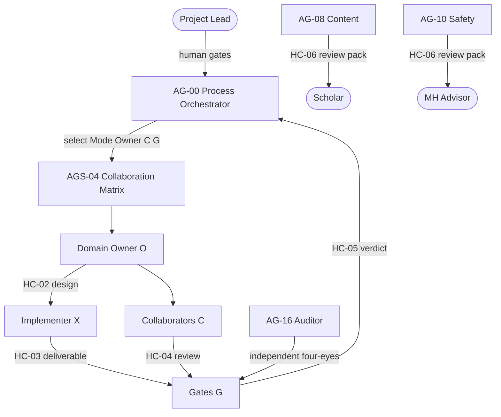

# Orchestration Policy — AGS-02 v0.2

> **Decision:** D-007 · **Task:** T-M3-011  
> **Selection authority:** [`agent-collaboration.md`](agent-collaboration.md) (AGS-04)

## 1. Model

A **governed Owner–Collaborator–Gate** model. AG-00 is the **process orchestrator**: it owns the task register, selects Mode / Owner / Collaborators / Gates from AGS-04, emits singleton HC-01 packets, sequences dependencies, and blocks progress when gates fail. AG-00 does **not** own domain correctness, override ADRs, or build product artefacts.

Domain **Owners** produce specifications and own correctness for their write paths. **Collaborators** co-design or review before Ready/build. **Implementers** produce code and artefacts against approved specifications. **Gates** (including AG-16 and human gates) may block Done. AG-16 audits independently (four-eyes).

## 2. Rules

1. **Work only from the register.** No task ID → no work.
2. **Matrix first.** Before assigning, AG-00 selects Mode, Owner, Collaborators, Gates, and Informed from AGS-04. Unclear Owner → AG-00 outputs the selection and stops (selective invocation).
3. **Spec before build.** An implementation task is "Ready" only when its spec, acceptance criteria and dependencies are Done (HC-02 from Owner when required).
4. **Single writer.** Each path has one owning agent (registry "Writes to" / AGS-04 Owner). Others propose changes through review comments or a change request.
5. **Four-eyes.** Every deliverable gets an independent review (AG-16 or the named Gate). Authors never approve their own work.
6. **Human gates** (`AGENTS.md` §7) block the next milestone and cannot be bypassed by agents.
7. **WIP limit:** ≤ 2 in-progress tasks per agent.
8. **Parallel streams:** concurrent HC-01 packets only when `may_write` paths do not overlap; AG-00 synthesises via HC-05 rollup and the weekly report.
9. **Escalation:** blocked > 1 working day, a requirement gap, a rule conflict, or a failed review twice → AG-00 → Project Lead.
10. **Cadence:** AG-00 writes a weekly report in `docs/10-project-management/weekly-reports/YYYY-Www.md` (done, next, risks, gate status).
11. **Minimum sufficient.** Invoke only agents whose domains are touched; record considered-but-not-needed always-on checklist items from AGS-04 §4.

## 3. Task lifecycle

`Backlog → Ready → In Progress → In Review → Done` (or `Blocked`, `Rejected → In Progress`).

**Ready** requires: dependencies Done; Mode/O/C/G set on the HC-01 packet; Owner design (HC-02) complete when the mode is not Fast path.

## 4. Running the agents (tooling-neutral)

- Each agent session starts with: `AGENTS.md` + its agent file + its SKILL.md files + the HC-01 task packet (which includes `mode`, `owner`, `collaborators`, `gates`, `informed`).
- Owners also read AGS-04 for their path row when designing or reviewing.
- Agents operate on a feature branch named `T-Mx-NNN-short-name` and open a PR that references the task. The PR template enforces the DoD.
- Development-time coding assistants are allowed for building. They are tools, not product components.
